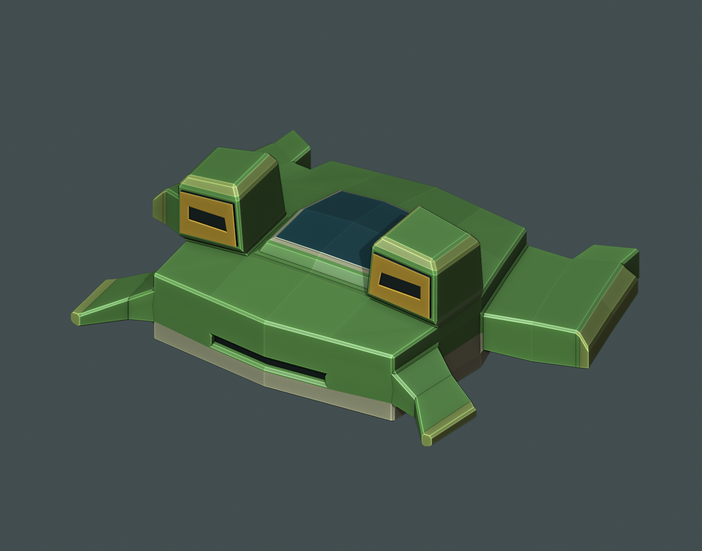

# RANA-56 · Nave espacial

Modelo de una nave exploradora inspirada en una rana, realizado en Blender a partir de un solo cubo.

**Juan Jose Rivas Alvarez · Carnet 24856**  
Laboratorio 3 de Gráficas

## Diseño

El casco ancho y verde recuerda el cuerpo de una rana. Los ojos elevados funcionan como sensores dorados, la cabina ocupa el centro y la toma de aire frontal forma una pequeña boca. Las patas delanteras son estabilizadores; las traseras alojan los propulsores turquesa.

## Archivos

| Archivo | Contenido |
| --- | --- |
| [Modelo OBJ](RANA_56_Juan_Jose_Rivas_Alvarez_24856.obj) | Nave lista para cargar, con todas las caras trianguladas. |
| [Materiales MTL](RANA_56_Juan_Jose_Rivas_Alvarez_24856.mtl) | Siete colores base planos. Conservar junto al OBJ. |
| [Proyecto Blender](RANA_56_editable.blend) | Modelo editable con un único objeto y modificador Bevel. |
| [Vista previa](RANA_56_vista_previa.png) | Imagen fija del modelo. |
| [Giro en GIF](RANA_56_giro_Discord.gif) | Vuelta completa para compartir en Discord. |

## Construcción

- Cubo inicial subdividido y transformado con Move y Scale.
- Extrude e Inset para la cabina, los sensores, los estabilizadores y las toberas.
- Modificador Bevel de un segmento en los bordes estructurales.
- Una sola malla conectada y cerrada, sin agregar otras mallas ni unir objetos.
- Materiales de color base uniforme, sin texturas.
- Exportación OBJ con modificadores aplicados y **1,232 triángulos**.

El OBJ se volvió a importar para verificar la triangulación, los materiales y la integridad de la malla. El archivo `.blend` conserva la topología editable antes de triangular.

## Abrir el modelo

En Blender, usar **Archivo > Abrir** para cargar el `.blend`, o **Archivo > Importar > Wavefront (.obj)** para cargar el OBJ. Mantener el `.obj` y el `.mtl` en la misma carpeta para conservar los colores.

