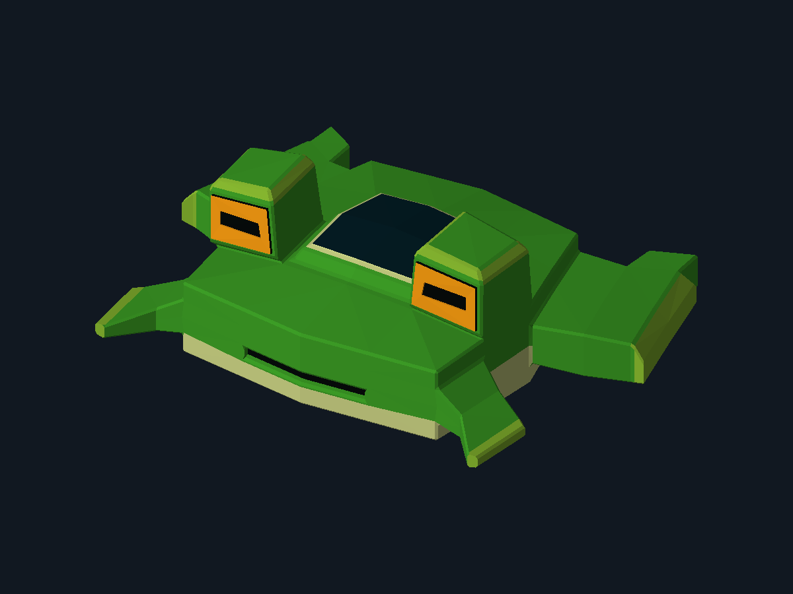
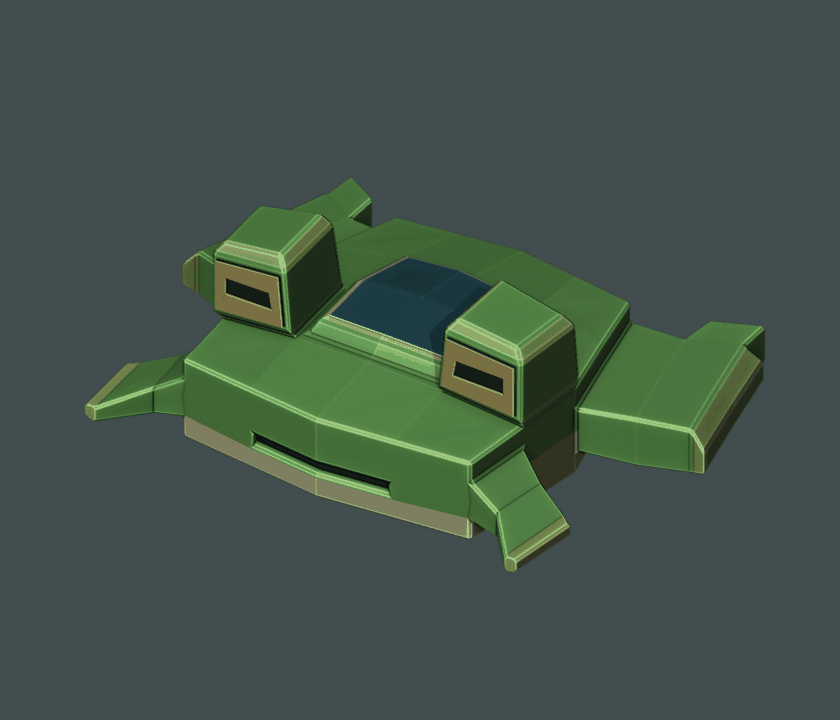

# Laboratorio 4 · Carga de OBJ y renderizado de triángulos

**Juan Jose Rivas Alvarez · Carnet 24856**  
Primer ejercicio del proyecto de Gráficas. Rama: `lab4-renderizador-obj`.

Renderizador por software en **C++17 y SDL2** que carga la nave RANA-56 del Lab3, recorre manualmente sus caras y dibuja los triángulos en un framebuffer propio.

## Resultado del programa



[Descargar PNG de la entrega](renders/rana_renderizada.png)

Esta imagen de **1200 × 900** sale directamente del framebuffer del programa. Se procesan **618 vértices y 1,232 triángulos**, con los siete colores base del MTL. La captura está centrada: sus límites son `(144, 192)` a `(1055, 708)`, con un margen horizontal del 12% por lado.

## Cómo se dibuja

1. [`obj_loader.cpp`](src/obj_loader.cpp) lee las posiciones `v` y las caras `f` con `std::getline` y `std::istringstream`. No utiliza un cargador de modelos externo.
2. Extrae el primer índice de cada referencia de cara, incluso en formatos `v/vt`, `v//vn` y `v/vt/vn`. Convierte los índices de OBJ, que empiezan en 1, a índices de C++ desde 0. También admite índices negativos y rechaza caras sin triangular o fuera de rango.
3. [`renderer.cpp`](src/renderer.cpp) transforma los vértices a una vista ortográfica, calcula sus límites y ajusta la escala y el desplazamiento para centrar la nave.
4. Recorre **todas** las caras, obtiene explícitamente los tres índices y recupera sus tres vértices:

```cpp
for (const Face& face : mesh.faces) {
    const std::size_t i0 = face.vertexIndices[0];
    const std::size_t i1 = face.vertexIndices[1];
    const std::size_t i2 = face.vertexIndices[2];
    const Vec3 v0 = mesh.vertices[i0];
    const Vec3 v1 = mesh.vertices[i1];
    const Vec3 v2 = mesh.vertices[i2];
    // v0, v1 y v2 permiten calcular la normal y el color de esta cara.
    // projected contiene estos mismos vértices transformados a pantalla.
    triangle(buffer, projected[i0], projected[i1], projected[i2], currentColor);
}
```

5. [`triangle.h`](src/triangle.h) rellena cada triángulo usando coordenadas baricéntricas e interpola su profundidad. El z-buffer evita que las superficies posteriores tapen las delanteras.
6. [`main.cpp`](src/main.cpp) usa SDL2 para la ventana, los eventos y la presentación de los píxeles mediante una textura. El dibujo de los triángulos se hace en la CPU, sin OpenGL ni funciones de triángulos de SDL.

La iluminación plana ayuda a distinguir las caras. El PNG contiene los mismos píxeles que se presentan en la ventana; no es el render anterior de Blender.

## Compilar y ejecutar

Requisitos: **CMake 3.20 o posterior**, compilador **C++17** y SDL2. CMake busca SDL2 instalado y, si no está disponible, descarga la versión oficial fijada [SDL 2.32.10](https://github.com/libsdl-org/SDL/releases/tag/release-2.32.10). La primera configuración requiere internet en ese caso.

### Windows con Visual Studio 2022

Instalar la carga de trabajo «Desarrollo para el escritorio con C++» y las herramientas de CMake. Abrir **Developer PowerShell for VS 2022** y ejecutar desde el repositorio:

```powershell
git switch lab4-renderizador-obj
cmake -S . -B build -G "Visual Studio 17 2022" -A x64
cmake --build build --config Release --parallel
.\build\Release\rana_renderer.exe
```

En Windows se descarga el SDK oficial precompilado de SDL2 con verificación SHA-256. La compilación copia el OBJ, el MTL y `SDL2.dll` junto al ejecutable; también se puede abrir ese ejecutable directamente.

### Linux

En Debian/Ubuntu, instalar las dependencias y compilar:

```bash
sudo apt install build-essential cmake libsdl2-dev
cmake -S . -B build -DCMAKE_BUILD_TYPE=Release
cmake --build build --parallel
./build/rana_renderer
```

### Generar la imagen de entrega

Desde la raíz del repositorio, en Windows:

```powershell
.\build\Release\rana_renderer.exe --headless --output renders/rana_renderizada.png
```

En Linux:

```bash
./build/rana_renderer --headless --output renders/rana_renderizada.png
```

`--headless` ejecuta el mismo renderizador y guarda el PNG sin abrir una ventana. Para otro OBJ triangulado, usar `--model ruta/modelo.obj`; su MTL debe estar disponible en la ruta indicada por `mtllib`.

Controles de la ventana:

| Tecla | Acción |
| --- | --- |
| Flechas izquierda/derecha | Girar la vista alrededor de la nave. |
| Flechas arriba/abajo | Cambiar la elevación de la vista. |
| R | Recuperar la vista inicial. |
| P | Guardar la vista actual como PNG. |
| Escape | Salir. |

La tecla P guarda por defecto `renders/rana_renderizada.png` relativo al directorio de ejecución. `--output` permite elegir otra ubicación.

## Verificación

```bash
ctest --test-dir build -C Release --output-on-failure
```

Las tres pruebas comprueban:

- Lectura manual de índices OBJ, errores de caras, relleno, winding, recorte, profundidad y encuadre del modelo real en varias vistas.
- Generación de un PNG con el renderizador completo.
- Presentación de un frame mediante SDL con su controlador de vídeo `dummy`.

Validado en Windows x64 con Visual Studio 2022 y SDL2 2.32.10: **3/3 pruebas aprobadas**. Las instrucciones de Linux se incluyen para portabilidad; no se ejecutaron en este entorno.

## Modelo original del Laboratorio 3

La nave se modeló en Blender a partir de un solo cubo. Los archivos originales se conservan en esta rama.

### Diseño de la nave

El casco ancho y verde recuerda el cuerpo de una rana. Los ojos elevados funcionan como sensores dorados, la cabina ocupa el centro y la toma de aire frontal forma una pequeña boca. Las patas delanteras son estabilizadores; las traseras alojan los propulsores turquesa.

### Archivos originales

| Archivo | Contenido |
| --- | --- |
| [Modelo OBJ](RANA_56_Juan_Jose_Rivas_Alvarez_24856.obj) | Nave lista para cargar, con todas las caras trianguladas. |
| [Materiales MTL](RANA_56_Juan_Jose_Rivas_Alvarez_24856.mtl) | Siete colores base planos. Conservar junto al OBJ. |
| [Proyecto Blender](RANA_56_editable.blend) | Modelo editable con un único objeto y modificador Bevel. |
| [Vista previa](RANA_56_vista_previa.png) | Imagen fija del modelo. |
| [Giro en GIF](RANA_56_giro_Discord.gif) | Vuelta completa para compartir en Discord. |

### Construcción en Blender

- Cubo inicial subdividido y transformado con Move y Scale.
- Extrude e Inset para la cabina, los sensores, los estabilizadores y las toberas.
- Modificador Bevel de un segmento en los bordes estructurales.
- Una sola malla conectada y cerrada, sin agregar otras mallas ni unir objetos.
- Materiales de color base uniforme, sin texturas.
- Exportación OBJ con modificadores aplicados y **1,232 triángulos**.

El OBJ se volvió a importar para verificar la triangulación, los materiales y la integridad de la malla. El archivo `.blend` conserva la topología editable antes de triangular.

### Abrir el modelo en Blender

En Blender, usar **Archivo > Abrir** para cargar el `.blend`, o **Archivo > Importar > Wavefront (.obj)** para cargar el OBJ. Mantener el `.obj` y el `.mtl` en la misma carpeta para conservar los colores.


